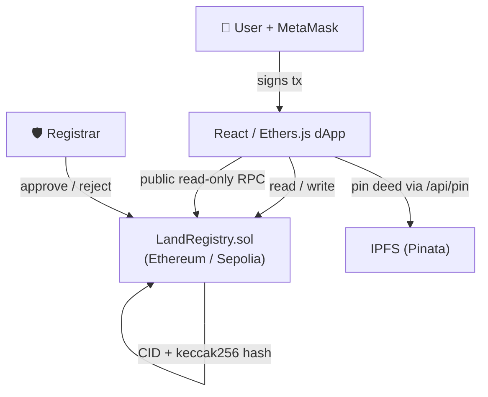

# 🏛️ LandLedger — Decentralized Land / Property Registry

> A blockchain-based system for **secure, transparent property-ownership management**.
> Tamper-resistant records, a permanent transfer history, and rule-based transfers —
> with a Registrar still verifying every initial claim.


---

## ⚖️ Honesty first

This project is deliberately honest about what a blockchain can and cannot do:

- ✅ It makes records **tamper-resistant**, history **transparent**, and transfers **rule-based**.
- ✅ It **rejects on-chain duplicates** (same deed hash, same survey+location) and **flags** suspicious activity.
- ❌ It does **not** verify real-world identity, **cannot** prove a submitted deed is genuine (a **Registrar** must), and does **not** grant legal recognition.

Blockchain is "garbage in, garbage out" — so a trusted Registrar approves every initial registration. The system **reduces and flags** fraud; it does not eliminate it. See [docs/LIMITATIONS.md](docs/LIMITATIONS.md).

---

## ✨ Features

**Smart contract (`contracts/LandRegistry.sol`)**
- OpenZeppelin `AccessControl` (DEFAULT_ADMIN_ROLE + REGISTRAR_ROLE), `ReentrancyGuard`, `Pausable`
- Submit → Registrar approve/reject → owner-initiated, buyer-accepted transfers
- Append-only transfer history, owner→ids index, paginated views, stats
- Duplicate-hash & duplicate survey+location rejection, one pending transfer per property
- `FlaggedForReview` when a wallet exceeds 3 submissions in 24h
- Custom errors, NatSpec on every function, packed structs, `uint64` timestamps, `calldata`

**Frontend (React + Vite + TS)** — 11 pages
- Landing, Dashboard, Register wizard, Registrar Console, Transfer Center, Registry Explorer, Property Detail, Analytics, Fraud Alerts, Public Verify, About/Architecture
- Dark/light theme, Framer Motion micro-interactions, command palette (⌘K), transaction tracker drawer, guided demo tour
- **Demo mode** works with zero setup (bundled synthetic data) — perfect for a 3-minute evaluation
- **Live mode** reads/writes on-chain via MetaMask with decoded custom-error messages

**Off-chain risk scoring (`frontend/src/lib/riskScore.ts`)** — pure, unit-tested
- Duplicate survey, reused document, bulk submissions, rapid flipping, circular trades, invalid survey format, new-wallet-high-volume

---

## 📸 Screenshots to capture

Save these into `docs/screenshots/` (filenames referenced in the project report):

| File | Page | What to show |
|---|---|---|
| `01-landing.png` | `/` | Hero + live stats + honest-limitations |
| `02-dashboard.png` | `/app` | KPIs, sparklines, My Properties |
| `03-register.png` | `/register` | Upload step with the animated hash fingerprint |
| `04-registrar.png` | `/registrar` | Risk-sorted pending queue + document viewer |
| `05-transfers.png` | `/transfers` | Initiate + incoming + two-party progress |
| `06-explorer.png` | `/explorer` | Filterable table + CSV export |
| `07-property-verified.png` | `/property/1` | Verify tool showing a MATCH (emerald shield) |
| `08-property-tampered.png` | `/property/1` | Verify tool showing a TAMPERED result (rose alert) |
| `09-analytics.png` | `/analytics` | Recharts dashboard |
| `10-fraud.png` | `/fraud` | Flagged records with scenario explanations |
| `11-public-verify.png` | `/verify` | Read-only lookup |
| `12-about.png` | `/about` | Architecture diagram |

---

## 🏗️ Architecture



Only the IPFS **CID** and the deed's **keccak256 hash** are stored on-chain — never the document itself. Full diagrams (sequence + data model) are in [docs/ARCHITECTURE.md](docs/ARCHITECTURE.md).

---

## 📁 Folder structure

```
ammachi/
├─ contracts/LandRegistry.sol        # Phase 1 — the smart contract
├─ test/LandRegistry.test.ts         # Phase 2 — 48 tests
├─ scripts/
│  ├─ lib/{dataset,pdf,ipfs,output}.ts
│  ├─ generateDataset.ts             # Phase 3 — writes /data CSVs + PDFs
│  ├─ seed.ts                        # Phase 3 — seeds the chain + reports
│  └─ deploy.ts                      # Phase 6 — deploy + verify
├─ data/                             # synthetic dataset (generated)
│  ├─ wallets.csv properties.csv transfers.csv
│  ├─ documents/*.pdf                # P-030 reuses deed-011.pdf
│  └─ seed-report.json
├─ frontend/
│  ├─ src/
│  │  ├─ pages/ components/ providers/ hooks/ lib/
│  │  ├─ lib/riskScore.ts (+ .test.ts)   # Phase 4
│  │  ├─ contracts/{deployment.json,landRegistry.ts}  # auto-generated
│  │  └─ data/registryIndex.json          # off-chain index for the UI
│  ├─ api/pin.ts                     # Vercel Edge fn (keeps Pinata JWT server-side)
│  └─ vercel.json
├─ docs/                             # Phase 7 — ARCHITECTURE, SECURITY, LIMITATIONS, …
├─ hardhat.config.ts
└─ .env.example
```

---

## 🚀 Setup & run (exact commands)

**Prerequisites:** Node 18+ (tested on Node 24), npm, and MetaMask for Live mode.

### 1. Install

```bash
npm install
cd frontend && npm install && cd ..
```

### 2. Compile, test, coverage (Phases 1–2)

```bash
npm run compile
npm test
npm run coverage
```

### 3. Generate the dataset (Phase 3)

```bash
npm run gen:dataset
```

### 4. Run everything locally (the full demo)

Open **two terminals**:

```bash
# terminal 1 — local blockchain
npm run node
```

```bash
# terminal 2 — deploy + seed the synthetic data (writes the frontend contract binding)
npm run seed:local
```

```bash
# frontend
cd frontend
npm run dev        # http://localhost:5173
```

> The frontend opens in **Demo mode** (bundled synthetic data) with no wallet required.
> To use **Live mode**: import a Hardhat test account into MetaMask, add the `Localhost 8545`
> network (chainId 31337), connect, and toggle **Live**. Account #0 is the Registrar.

### 5. Risk-scoring unit tests (Phase 4)

```bash
cd frontend && npm test
```

---

## 🌐 Deploy to Sepolia + Vercel (Phase 6)

1. Copy `.env.example` → `.env` and fill `SEPOLIA_RPC_URL`, `DEPLOYER_PRIVATE_KEY` (funded with Sepolia ETH), `ETHERSCAN_API_KEY`.
2. Deploy & verify:
   ```bash
   npm run deploy:sepolia
   ```
   This writes the address + ABI to `frontend/src/contracts/` and verifies on Etherscan.
3. Deploy the frontend on Vercel (root = `frontend/`). Set env vars from `frontend/.env.example`, including the **server-only** `PINATA_JWT` so `/api/pin` can pin documents without exposing the secret.
4. Record your live URLs in the checklist below.

See [docs/DEPLOYMENT.md](docs/DEPLOYMENT.md) for the full checklist.

---

## 🔑 Environment variables

| Scope | Variable | Purpose |
|---|---|---|
| Root | `SEPOLIA_RPC_URL` | RPC for deployment |
| Root | `DEPLOYER_PRIVATE_KEY` | Deployer = admin + first registrar |
| Root | `ETHERSCAN_API_KEY` | Contract verification |
| Root | `PINATA_JWT` | Server-side IPFS pinning (seed script) |
| Frontend (public) | `VITE_CONTRACT_ADDRESS` | Override contract address |
| Frontend (public) | `VITE_CHAIN_ID` | 11155111 / 31337 |
| Frontend (public) | `VITE_PUBLIC_RPC_URL` | Read-only RPC for Public Verify |
| Frontend (**server only**) | `PINATA_JWT` | Used by `api/pin.ts` only |

No secrets are shipped to the browser — the only public on-chain value is the contract address.

---

## 🧪 Testing

- **Contract:** 48 Hardhat/Chai tests, `100%` statements / functions / lines, `~89%` branches.
- **Risk library:** 13 Vitest tests.
- Reproduce: `npm test`, `npm run coverage`, then `cd frontend && npm test`. Details in [docs/TEST_REPORT.md](docs/TEST_REPORT.md).

---

## 🆘 Troubleshooting

| Symptom | Fix |
|---|---|
| `seed:local` says it needs 8 signers | Run against a local node (`npm run node`); Sepolia seeding needs multiple funded keys. |
| Frontend shows an empty contract in Live mode | Re-run `npm run seed:local` — it redeploys and rewrites `frontend/src/contracts`. |
| IPFS CIDs look like `bafymock…` | No `PINATA_JWT` set — the mock store is used (clearly logged). Documents render from `/demo-docs`. |
| MetaMask "wrong network" | Click **Switch network** in the header; it adds/activates the expected chain. |
| Document preview blank in Demo | Demo deeds are served from `frontend/public/demo-docs` after seeding. |

---

## 📚 Documentation

- [docs/ARCHITECTURE.md](docs/ARCHITECTURE.md) — system + sequence diagrams, data model
- [docs/SECURITY.md](docs/SECURITY.md) — threat model & self-audit
- [docs/LIMITATIONS.md](docs/LIMITATIONS.md) — honest scope + future work
- [docs/DEMO_SCRIPT.md](docs/DEMO_SCRIPT.md) — timed 5-minute demo
- [docs/VIVA_QA.md](docs/VIVA_QA.md) — 30 evaluator Q&A
- [docs/TEST_REPORT.md](docs/TEST_REPORT.md) — test counts & coverage
- [docs/REPORT_OUTLINE.md](docs/REPORT_OUTLINE.md) — chapter-wise report outline
- [docs/DEPLOYMENT.md](docs/DEPLOYMENT.md) — deployment checklist

---

## 📝 License

MIT — academic project. All data shown is **synthetic**. Deployed on a **testnet**; not legally binding.
