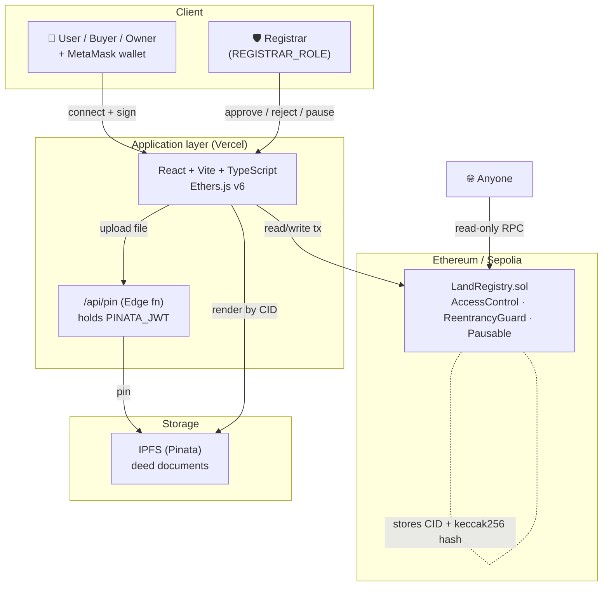
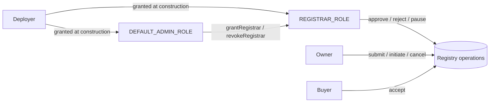
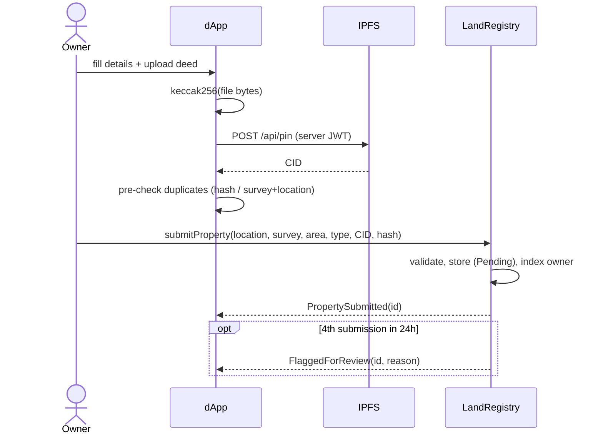
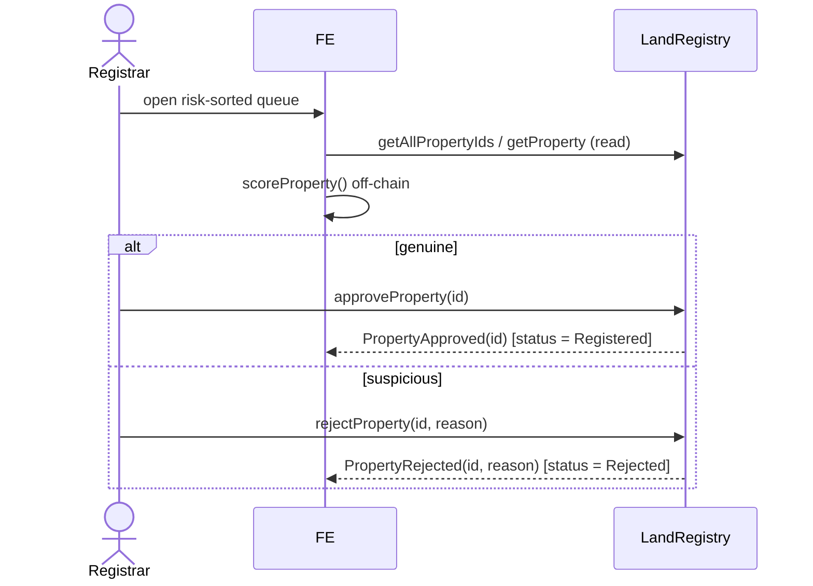
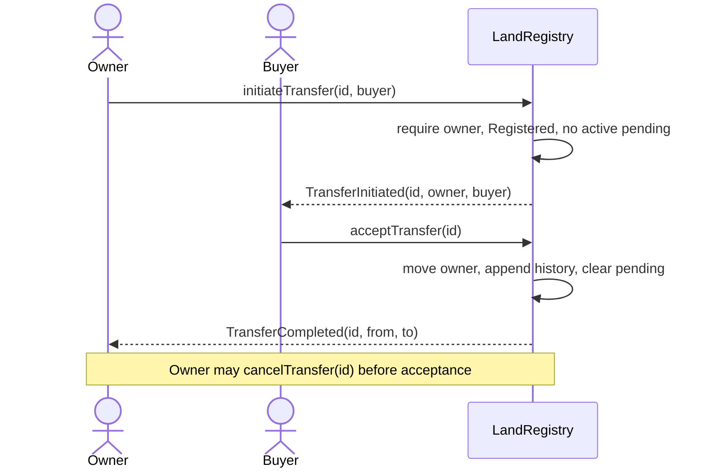
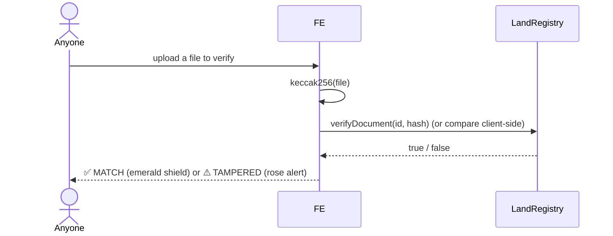
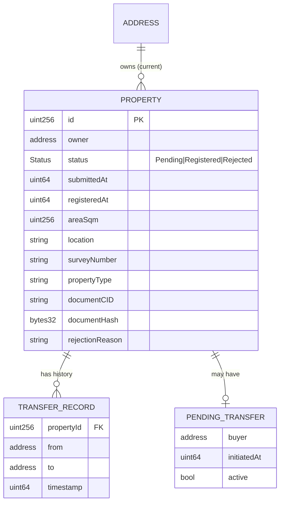

# Architecture

## 1. System overview

**Key principle:** documents never go on-chain. Only the IPFS **CID** and the
**keccak256 hash** of the file bytes are stored, so anyone can later prove a file
is the exact one registered without exposing private documents on a public ledger.

## 2. Roles

## 3. Sequence — Register a property

## 4. Sequence — Registrar approval

## 5. Sequence — Transfer ownership (two-party)

## 6. Sequence — Verify a document (tamper check)

## 7. Data model (on-chain)

**Indexes maintained in storage:** `documentHash → used`,
`keccak(survey‖location) → id`, `owner → uint256[]` (swap-and-pop),
`buyer → incoming ids`, global `uint256[]` for pagination, and a per-wallet
rolling 24h submission log (self-pruning) for the flag heuristic.

## 8. Off-chain layer

- `scripts/seed.ts` replays the synthetic dataset and writes
  `frontend/src/data/registryIndex.json` (UI data) and `data/seed-report.json`
  (fraud demo). The simulated clock is anchored at node start and advanced per
  event's calendar offset so 24h/30-day windows behave as intended.
- `frontend/src/lib/riskScore.ts` is a pure function scoring each property
  0–100 (Low/Medium/High) from cross-record signals. It complements — never
  replaces — the hard on-chain guarantees.
